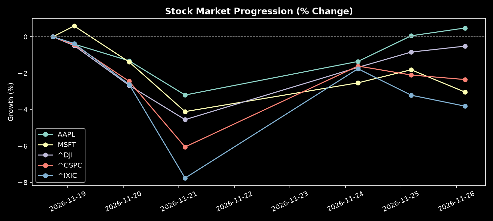

# 🌐 Atlas Global Market Terminal

[](https://stock-market-worlsgit-6tqj5e7dqok7rsivjdjqka.streamlit.app/#latest-market-snapshot)


An interactive financial market intelligence dashboard and automated stock tracker built with **Python**, **Streamlit**, **Plotly**, **yfinance**, and **GitHub Actions**.

---

##  Automated Market Progression
*This chart updates automatically Monday through Friday after market close via GitHub Actions.*



---

##  Key Features

* ** Pro Technical Charting & News:** Interactive OHLC candlestick charts with toggleable 20-day and 50-day Simple Moving Averages (SMA), a 14-day Relative Strength Index (RSI) momentum panel, and live market news headlines.
* ** Multi-Asset Battleground:** Compare normalized percentage returns across global indices, equities, crypto, and commodities side-by-side from a 0% baseline.
* ** Wealth & DCA Simulator:** Simulate **Lump-Sum** vs. **Monthly Recurring (Dollar-Cost Averaging)** returns in **USD (\$)** or **Nigerian Naira (₦)** using live reference FX rates.
* ** Automated GitHub Data Pipeline:** Uses a scheduled GitHub Actions workflow (`track_market.yml`) to fetch daily market closes, log historical prices to `market_history.csv`, and regenerate `market_chart.png`.

---

##  Repository Structure

```text
├── .github/
│   └── workflows/
│       └── track_market.yml    # Scheduled automation workflow
├── .streamlit/
│   └── config.toml             # Custom dark terminal UI theme
├── app.py                      # Main Streamlit interactive web application
├── tracker.py                  # Automated market data fetcher & chart generator
├── market_history.csv          # Auto-logged daily market data
├── market_chart.png            # Auto-generated progression chart
├── requirements.txt            # Python dependencies
└── README.md                   # Project documentation
```

---

##  Run Locally

1. **Clone the repository:**
   ```bash
   git clone https://github.com
   cd YOUR-REPO
   ```

2. **Install dependencies:**
   ```bash
   pip install -r requirements.txt
   ```

3. **Launch the Streamlit app:**
   ```bash
   streamlit run app.py
   ```

---

## ⚠️ Disclaimer
This project is built for **educational and informational purposes only**. Market data is sourced from Yahoo Finance and may be delayed. Nothing in this application constitutes financial or investment advice.
